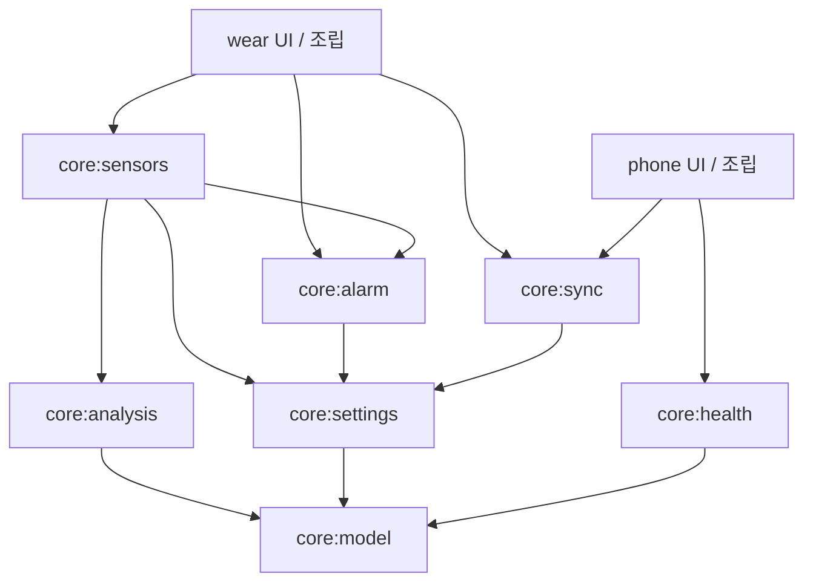
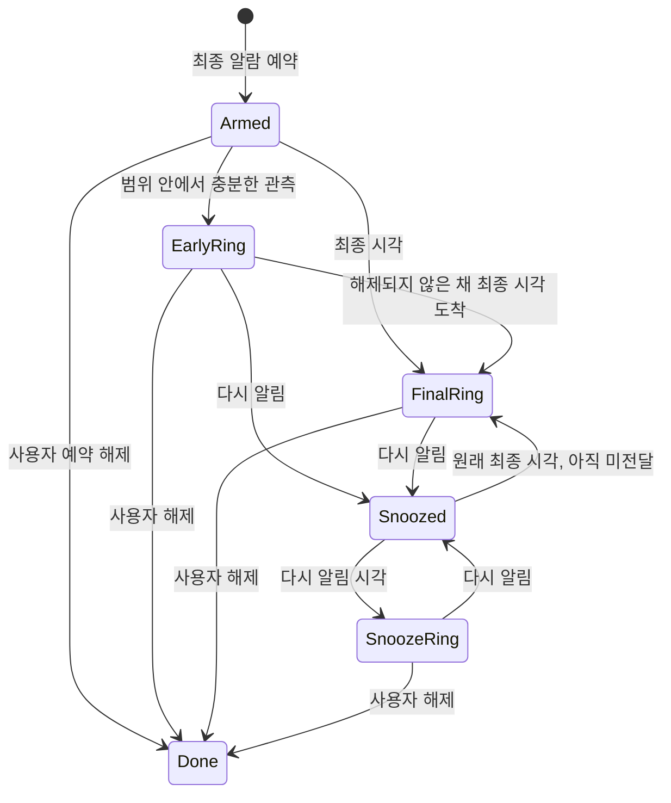

# 0.3.0 확장

`core:update`를 추가했습니다. 알람·분석 모듈은 업데이트 모듈을 참조하지 않습니다. 다운로드/전송/사용자 승인/서명 검증은 별도 WorkManager/PackageInstaller 경로이며 업데이트 모듈은 보호 목적으로 저장된 워치 예약을 읽기만 합니다. 전체 설계와 배포/최초 전환 제약은 [UPDATES.md](UPDATES.md)를 참고하세요.

# 구조와 동작

0.2.0 적응형 시간 정책·개인화·동일 관측 비교·알람 정책은 [ADAPTIVE_ALGORITHM.md](ADAPTIVE_ALGORITHM.md)를 우선 참고하세요. 아래 0.1.1 규칙 설명은 보존한 비교 엔진의 동작을 설명합니다.

## 모듈과 경계

`model`, `analysis`는 Android 없는 Kotlin/JVM 모듈입니다. Android API는 어댑터 모듈에만 있습니다. 앱 모듈이 권한·UI·전송 수신을 조립합니다. 센서 모듈은 알람 모듈의 공개 `AlarmController.smartWake`만 호출합니다. 알람 모듈에는 센서 모듈 의존성이 없고, 상태 변화·범위 시작은 패키지 한정 브로드캐스트 계약으로 전달합니다. 모든 컴포넌트는 동일한 앱 프로세스를 사용합니다.

- `AlarmSettings`: 입력 범위 검증, 다음 기상 Instant 계산. DST 간격은 다음 유효 시각으로, 중복 시각은 기본 앞선 offset으로 해석.
- `AlarmPlan`: 최종 시각, 설정 스냅샷, 조기/최종 알람 전달 여부, 다시 알림 시각, 현재 알람 nonce.
- `AlarmTransitions`: Android 없는 상태 전이 규칙. 오래된 세션·중복 이벤트·오래된 알림 동작 거부.
- `WakeEstimator`: 실시간 관측 → 기상 권고. 현재 `ConservativeWakeEstimator` 구현.
- `SleepHistoryRepository`: Health Connect → 기록 모델 변환. Samsung Health 출처 필터, 페이지네이션.
- `PersonalizationProvider`: 후속 기록 기반 개인화의 입력 경계. 현재는 구현하지 않음.

## 일반 알람이 먼저

1. 워치에서 정확한 알람 권한을 확인하고 새 세션 ID를 만듭니다.
2. `setAlarmClock`으로 최종 시각 PendingIntent를 먼저 예약합니다.
3. 앱의 직접 부팅 저장소에 계획·설정 스냅샷을 동기 저장합니다. 이전 계획 이벤트를 정리합니다.
4. 스마트 범위 시작은 별도 `setExactAndAllowWhileIdle`로 예약합니다. 이 단계 실패는 최종 알람을 취소하지 않습니다.
5. 심박 수동 수신을 요청합니다. Health Services의 capability·권한·연결 실패는 일반 알람과 분리합니다.
6. 최종 Receiver는 데이터베이스나 센서 결과를 읽지 않고 보관된 계획으로 RingingService를 시작합니다.

사용자에게 설정한 최종 기상 시각의 일반 알람은 독립 경로로 남습니다. 조기 알람은 최종 이벤트를 삭제하지 않습니다. 실제 기상 확인에 해당하는 ‘해제’는 전체 계획을 종료합니다. 사용자가 다시 알림을 누르면 별도 정확 알람이 추가됩니다. 최종 이벤트가 먼저 도착하면 미도착 다시 알림은 정리합니다.

알림 동작에는 세션의 `ringNonce`를 넣습니다. 이전 알람의 오래된 해제·다시 알림 버튼으로 새 알람을 조작할 수 없습니다. PendingIntent는 세션 ID와 이벤트가 들어간 고유 URI를 사용하고 immutable로 만듭니다.

저장소는 같은 프로세스에서 하나의 lock으로 직렬화합니다. 여러 프로세스에서 SharedPreferences를 동시에 사용하는 설계가 아닙니다. 저장소와 AlarmManager 사이에 OS 차원의 원자적 트랜잭션은 없으므로 예약 도중 비정상 종료의 극히 짧은 간격까지 완전 보장하지 않습니다. 앱 재진입·부팅 Receiver는 저장된 계획을 재예약합니다.

## 상태 전이

재부팅 시 아직 미래인 최종·다시 알림을 재예약합니다. 울리고 있던 상태는 짧은 복원용 `setAlarmClock`을 예약해 부팅 Receiver에서 mediaPlayback FGS를 직접 시작하지 않습니다. 최종 시각이 이미 지났으면 가능한 시점에 복구 알람을 예약합니다. 최종 시각은 절대 Instant로 보관하며 시간대 변경만으로 다른 날짜로 이동하지 않습니다. 일일 반복은 미구현입니다.

## 실시간 센서

- 심박: `HealthServices.getClient().passiveMonitoringClient`, `PassiveListenerService`.
- capability에서 `HEART_RATE_BPM` 지원을 확인한 뒤 등록합니다. 백그라운드 센서 권한을 검사합니다.
- Health Services가 제공하는 **부팅 이후 측정 시각**을 실제 wall-clock으로 환산합니다. 수신 시각을 측정 시각으로 사용하지 않습니다.
- 심박 품질은 MEDIUM/HIGH만 사용합니다. 품질 필드가 없거나 낮거나 접촉이 불확실하면 조기 판단에서 제외합니다.
- 가속도: 스마트 범위에서만 health FGS를 사용해 약 5 Hz 요청, 10초 배치. 이 값은 요청일 뿐 전달 주기를 보장하지 않습니다.
- wake-up 가속도 센서를 우선 사용하고 없으면 일반 센서로 축소합니다. 밤새 CPU wake lock을 잡지 않습니다. 화면 꺼짐·Doze에서 데이터가 비면 품질 관문을 통과하지 못하므로 최종 알람을 기다립니다.
- `MotionAccumulator`는 5초 고정 bin에 RMS 에너지를 시간 가중 집계합니다. 연속 이벤트 간격이 1초를 넘으면 그 공백을 관측 시간으로 세지 않습니다. 도착 빈도로 신뢰도를 부풀리지 않습니다.
- 스마트 범위 서비스가 시스템 시각 점프(2초 초과)를 감지하면 그 세션 조기 판단을 중지합니다. 최종 알람은 RTC API의 시스템 시각 변화 동작을 따릅니다.
- 스마트 범위 서비스가 종료돼도 최종 예약은 유지됩니다. 센서 서비스는 `START_NOT_STICKY`, 실제 알람 서비스는 저장된 울림 상태를 재확인하는 `START_STICKY`입니다.

## 규칙 기반 기상 권고

모든 숫자는 초기 고정값이고 사용자별·기기별 검증이나 임상 보정이 되지 않았습니다.

- 10~14분 범위는 **4분 기준 + 최근 2분 관측**, 15~60분 범위는 **6분 기준 + 최근 3분 관측**이 필요합니다. 관측 품질·심박 분산·두 센서 공동 근거 기준은 동일합니다.
- 양쪽 구간의 움직임 관측 비율이 각각 70% 이상이어야 합니다. 최근 움직임도 15초 이내여야 합니다.
- 기준 심박 3회 이상, 3분 이상 시간 분산; 최근 심박 3회 이상, 90초 이상 시간 분산이 필요합니다.
- 심박 간 공백은 최대 150초, 최신 값은 90초 이내, 구간 경계 근처 관측도 필요합니다. 중복·미래·불가능한 값은 제외합니다.
- 심박 중앙값 상승 4~18 bpm과 적당한 움직임의 증가가 함께 필요합니다.
- 큰 충격·급격한 심박 상승은 판단을 보류합니다.
- 서비스는 30초마다 평가하며 `SustainedWakeGate`가 **60초 동안 연속 통과한 경우**에만 `smartWake`를 허용합니다. 평가 간격이 45초를 넘거나 시각이 역행하거나 부정 판단이 나오면 확인을 다시 시작합니다.
- 10분 범위도 6분 관측 + 60초 확인 뒤 조기 판단 여유를 남깁니다. 최대 15초 등록 대기와 실제 30초 평가 주기, 5초 bin 위상 차이를 반영한 자동 시험에서 약 7분대 판단이 가능합니다. 센서 지연·공백·실제 기상 효과까지 보장하는 것은 아닙니다. 수동 심박 데이터가 늦으면 최종 알람을 기다립니다.

REM·얕은·깊은 수면 단계, 실제 각성 용이성, 수면 효율을 이 관측으로 산출하지 않습니다. 최종 알람은 엔진의 confidence나 데이터 유무를 검사하지 않습니다.

## 기록과 비교

삼성 헬스가 Health Connect에 쓴 `SleepSessionRecord`만 읽습니다. 최근 7일, 읽기 전 권한 확인, 페이지네이션을 적용합니다. 제공된 단계 시간만 합산하며 알 수 없는 구간을 얕은 수면 등으로 채우지 않습니다. 세션 길이와 알려진 수면 합계를 따로 표시합니다.

자체 보고서의 예약 시각은 수면 시작 시각이 아닙니다. 총 수면 시간을 만들어내지 않습니다. 첫 알람 시각과 삼성 기록 종료 시각이 6시간 안에 있는 가장 가까운 이력을 ‘비교 후보’로 표시하며, 정확한 세션 매칭이나 수면 단계 정확도 수치로 해석하지 않습니다.

## 전송

- 원격 예약: MessageClient, 프로토콜 v1, 요청 UUID, 생성·만료 시각(2분), 워치에서 중복 ID 재적용 방지.
- 명령을 영속 DataItem에 넣지 않으므로 나중에 연결됐을 때 오래된 기상 예약을 재실행하지 않습니다.
- 현재 UI는 연결된 워치 1대만 지원합니다. 양쪽 기기의 시각이 크게 다르면 원격 명령을 거절합니다. 워치에서 직접 예약할 수 있습니다.
- ‘전송됨’과 ‘예약 완료’를 구분합니다. 워치가 AlarmManager 예약에 성공한 후 ACK를 보냅니다.
- 요약 기록: DataClient의 `/sleep/v1/reports/{id}`. 오프라인에는 워치 로컬에 남고 재연결 시 전송 버튼·휴대전화 새로고침으로 재발행할 수 있습니다.
- 동일 packageName과 서명으로 Google Play Services가 연결을 제한합니다. 공유 폰/워치 앱 외 외부 네트워크 서버는 없습니다.

## 0.1.1 오류 처리와 시험 예약

`AlarmController.armTest`는 시험 계획 스냅샷만 `smartEnabled=false`로 만들며 사용자 설정 저장을 수행하지 않습니다. 시험은 기존 활성 예약을 교체하지만 저장된 다음 일반 알람 설정을 바꾸지 않습니다. 재부팅 복원도 시험 계획만 복원합니다.

`startForegroundService` 예외·null 반환은 Controller에서, 서비스 내부의 알림 생성·`ServiceCompat.startForeground` 예외는 RingingService에서 처리합니다. 전경 승격 실패 시 자원을 정리하고 `stopSelf` + `START_NOT_STICKY`로 시스템의 미승격 서비스 시간 초과 및 자동 재시작 루프를 피합니다. 정상 울림의 기존 START_STICKY 정책은 유지합니다.

대체 경로는 별도 ID 702/채널 `wake-fallback-v1`의 시스템 알람 소리·진동 알림과 제한된 1회 직접 진동을 각각 시도합니다. 별도 ID를 쓰므로 실패한 서비스의 `onDestroy`가 대체 알림을 제거하지 않습니다. 해제·다시 알림 동작은 같은 nonce 검증을 거치고 대체 알림·진동도 정리합니다. 알림 권한 거부/채널 차단/진동 장치 부재를 확인할 수 있으면 오류에 기록합니다. 게시·진동 요청 성공은 실제 사용자에게 전달되었다는 보장이 아닙니다.

오류는 Logcat `SleepAlarm`과 센서 상태와 분리된 `SettingsStore.alarmError`에 기록하고 워치 화면의 ‘최근 알람 오류’로 표시합니다. 새 예약에서 이전 오류를 초기화합니다. 음원·오디오 포커스·wake lock·자원 해제 오류도 앱 크래시로 전파하지 않습니다.

백그라운드 권한은 foreground 미허용, background 미요청/요청 후 미허용, 확인 가능한 설치 허용 목록 제한, 제한 메타데이터 확인 불가를 구분합니다. 공개 PackageManager 조회가 거부되거나 null이면 원인을 임의로 단정하지 않습니다. ‘항상 허용’ 선택 위치와 선택 불가능 시 설치 경로/기기 관리 정책 확인 방법을 안내합니다. 두 센서 권한을 한 번에 요청하지 않습니다.
